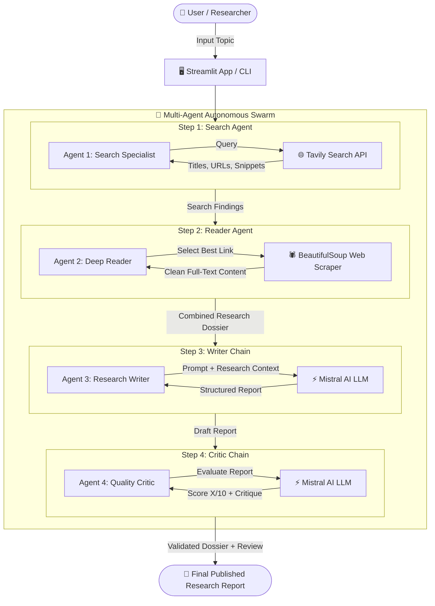

# 🔬 Autonomous Multi-Agent Research System

<div align="center">


<p align="center">
  <strong>An end-to-end autonomous research swarm that searches the live web, extracts deep primary source content, synthesizes structured reports, and performs automated peer reviews.</strong>
</p>

[Key Features](#-key-features) •
[System Architecture](#-system-architecture) •
[Interactive Web UI](#-interactive-web-ui) •
[Quickstart](#-quickstart--installation) •
[Project Structure](#-project-structure) •
[Workflow](#-how-it-works)

---

</div>

## 🌟 Overview

The **Autonomous Multi-Agent Research System** is an advanced AI workflow designed to automate complex technical and academic research. Instead of relying on a single prompt or hallucinated knowledge, it orchestrates a **swarm of specialized LangChain agents** working in a collaborative pipeline:

1. **Search Agent**: Scans the live web with Tavily AI for recent, authoritative sources.
2. **Reader Agent**: Autonomously inspects top search URLs and extracts full-text articles using BeautifulSoup.
3. **Writer Chain**: Synthesizes verified findings into a structured, citation-backed dossier.
4. **Critic Chain**: Evaluates the report rigorously, providing a constructive score (X/10), identified strengths, and potential gaps.

---

## 🚀 Key Features

- **🌐 Live Grounding via Tavily AI**: Real-time web search capabilities prevent hallucinations and ensure access to up-to-date data.
- **📖 Deep Scraping & Parsing**: Unlike simple search snippets, the Reader Agent digs into primary web documents, stripping boilerplate and scripts for high-density signal.
- **✍️ Rigorous Structured Synthesis**: Reports are automatically drafted with Executive Summaries, Key Findings (with explanations), Conclusions, and Source URLs.
- **⚖️ Automated Peer Review (Critic)**: Every drafted report is audited by an independent Critic persona that scores accuracy, clarity, and comprehensiveness.
- **🖥️ Dual Interfaces**:
  - **Streamlit Web Application** (`app.py`): Glassmorphic UI with real-time agent execution tracking, collapsible source views, and one-click Markdown downloads.
  - **CLI Pipeline** (`pipeline.py`): Fast, lightweight terminal interface with rich formatted logs.
- **🧩 Modular Architecture**: Clean separation between tools (`tools.py`), agent definitions (`agents.py`), pipeline logic (`pipeline.py`), and the presentation layer (`app.py`).

---

## 🏛️ System Architecture



---

## 🤖 The Agent Swarm

| Agent / Chain | Engine | Tools / Actions | Primary Responsibility |
| :--- | :--- | :--- | :--- |
| **Search Agent** | `Mistral-Small` | `web_search` (Tavily) | Formulates search queries and identifies top relevant web sources. |
| **Reader Agent** | `Mistral-Small` | `scrape_url` (Requests + BS4) | Selects the highest quality URL and deep-scrapes primary article text. |
| **Writer Chain** | `Mistral-Small` | LCEL Prompt Chain | Synthesizes raw notes into a multi-section structured report with sources. |
| **Critic Chain** | `Mistral-Small` | Evaluation Rubric Chain | Grades the draft (Score: X/10), outlines strengths, gaps, and final verdict. |

---

## 💻 Interactive Web UI

The project features a full-featured **Streamlit Web Application** in `app.py`:

- **Real-Time Pipeline Stepper**: Track which agent is currently executing (Search ➔ Reader ➔ Writer ➔ Critic).
- **Tabbed Results Inspection**:
  - 📄 **Research Report**: Rendered Markdown report with a one-click `.md` download button.
  - ⚖️ **Peer Review & Score**: Complete critique, breakdown, and score card.
  - 🔍 **Search Agent Data**: Inspect the exact Tavily search hits and URLs.
  - 📖 **Reader Agent Content**: Inspect the raw cleaned text scraped from primary sources.
- **Quick Suggestion Topics**: One-click preset prompts for immediate testing.
- **API Status Indicator**: Live detection of active API keys.

---

## ⚡ Quickstart & Installation

### 1. Clone the Repository
```bash
git clone https://github.com/your-username/Multi-agent-research-system.git
cd Multi-agent-research-system
```

### 2. Set Up a Virtual Environment

Using **uv** (recommended for ultra-fast setup):
```bash
uv venv
.venv\Scripts\activate   # Windows
# source .venv/bin/activate  # macOS / Linux
```

Or using standard **Python**:
```bash
python -m venv .venv
.venv\Scripts\activate   # Windows
# source .venv/bin/activate  # macOS / Linux
```

### 3. Install Dependencies
```bash
pip install -r requirements.txt
# or: uv pip install -r requirements.txt
```

### 4. Configure API Keys

Create a `.env` file in the root directory:
```env
MISTRAL_API_KEY=your_mistral_api_key_here
TAVILY_API_KEY=your_tavily_api_key_here
```

> **Where to get keys?**
> - **Mistral AI**: [console.mistral.ai](https://console.mistral.ai/)
> - **Tavily Search**: [app.tavily.com](https://app.tavily.com/)

---

## 🏃 Running the Application

### Option A: Launch the Streamlit Web UI (Recommended)
```bash
streamlit run app.py
```
Open your browser at `http://localhost:8501`.

### Option B: Run in Terminal (CLI Mode)
```bash
python pipeline.py
```
Enter your topic when prompted, and observe the agents output their progress directly in the console.

---

## 📁 Project Structure

```text
Multi-agent-research-system/
├── app.py              # 🚀 Streamlit Web Application (imports pipeline.py)
├── pipeline.py         # 🔄 Multi-agent execution orchestration & state management
├── agents.py           # 🧠 Agent builders, prompts, and LCEL chains
├── tools.py            # 🛠️ Tavily web search & BeautifulSoup scraping tools
├── requirements.txt    # 📦 Project dependencies
├── .env.example        # 🔑 Template for required API environment variables
└── README.md           # 📖 Project documentation
```

---

## 🔬 How It Works (Step-by-Step)

```
[Topic Input]
     │
     ▼
1. Search Agent ─────► Queries Tavily API for top 5 web hits with snippets & URLs
     │
     ▼
2. Reader Agent ─────► Analyzes snippets, chooses the most authoritative URL,
                       and scrapes up to 3,000 characters of clean body content
     │
     ▼
3. Writer Chain ─────► Combines search snippets + scraped body text; produces
                       Introduction, Key Findings, Conclusion, and Sources
     │
     ▼
4. Critic Chain ─────► Evaluates final draft against quality criteria;
                       outputs Score (X/10), Strengths, Areas to Improve, Verdict
```

---

## 📝 Example Output

### Research Report Example
```markdown
# Autonomous Driving Safety Standards in 2026

## Introduction
Autonomous vehicle (AV) deployment has transitioned from experimental testing
to standardized regulatory oversight across North America and Europe...

## Key Findings
1. ISO 26262 & SOTIF Compliance: Shift towards unified edge-case validation...
2. Multimodal Sensor Redundancy: Integration of 4D imaging radar alongside LiDAR...
3. Vision-Language-Action (VLA) Models: Emerging end-to-end architectures...

## Conclusion
The safety paradigm has decisively moved towards verifiable formal guarantees...

## Sources
- https://example.com/autonomous-safety-2026
- https://example.com/av-standards-report
```

### Critic Evaluation Example
```text
Score: 9/10

Strengths:
- Clear separation between regulatory frameworks and technical sensor stacks.
- Factual grounding with specific ISO standards cited.

Areas to Improve:
- Could mention edge-case simulation benchmarks in greater detail.

One line verdict:
An exceptionally structured, insightful, and well-sourced analysis.
```

---

## 🛠️ Tech Stack

- **Framework**: [LangChain](https://python.langchain.com/) (Agents, Tools, LCEL Expression Language)
- **Model Provider**: [Mistral AI](https://mistral.ai/) (`mistral-small-2506`)
- **Search Provider**: [Tavily AI](https://tavily.com/)
- **Scraping**: [BeautifulSoup4](https://www.crummy.com/software/BeautifulSoup/) & [Requests](https://requests.readthedocs.io/)
- **Frontend**: [Streamlit](https://streamlit.io/)
- **Terminal UI**: [Rich](https://github.com/Textualize/rich)

---

## 🤝 Contributing

Contributions, issues, and feature requests are welcome!
1. Fork the Project
2. Create your Feature Branch (`git checkout -b feature/AmazingFeature`)
3. Commit your Changes (`git commit -m 'Add some AmazingFeature'`)
4. Push to the Branch (`git push origin feature/AmazingFeature`)
5. Open a Pull Request

---

## 📄 License

Distributed under the MIT License. See `LICENSE` for more information.
